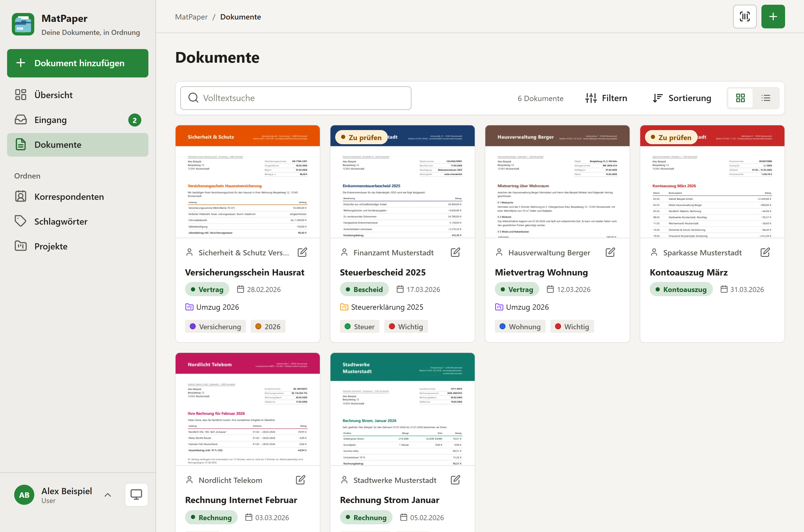
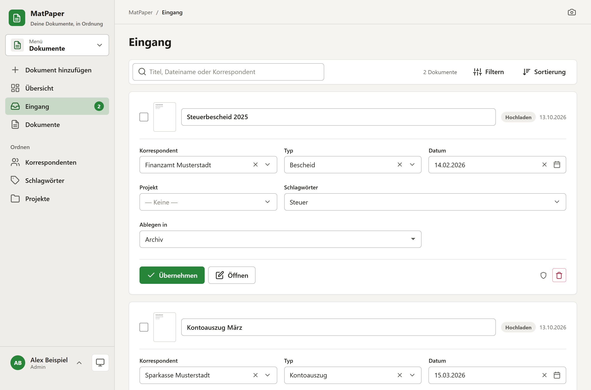
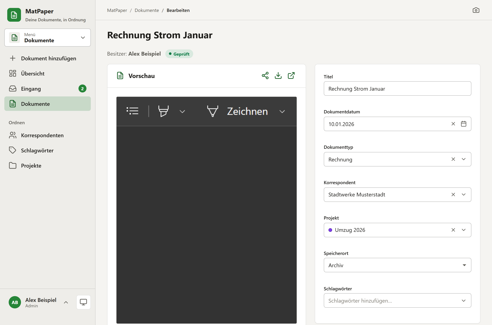
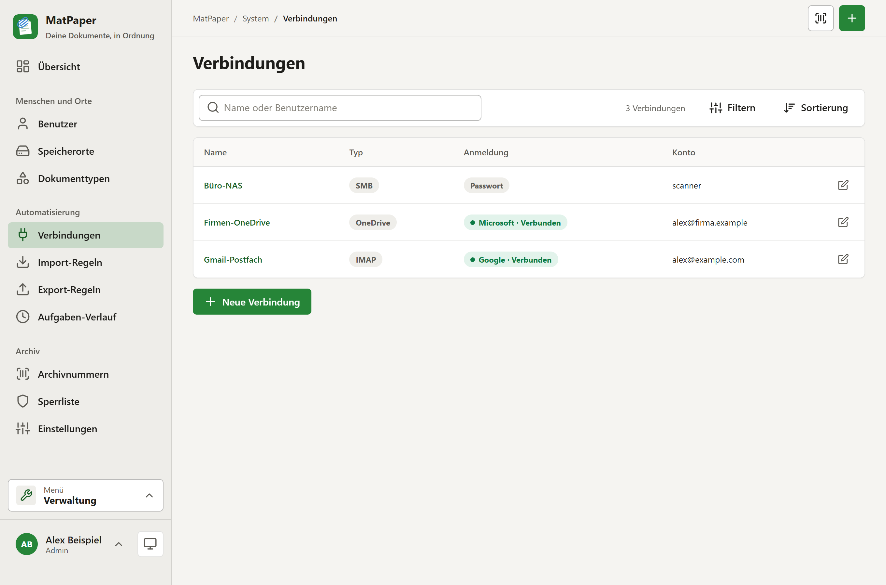
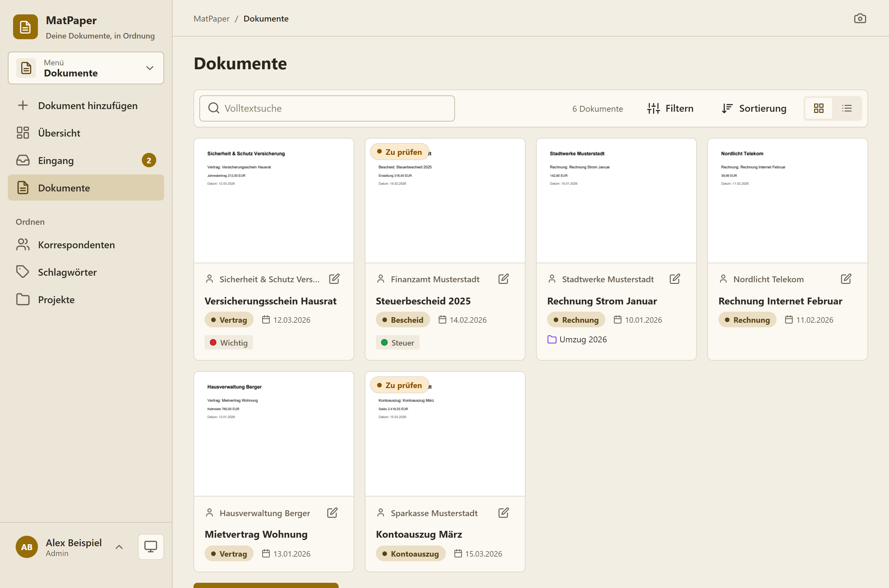
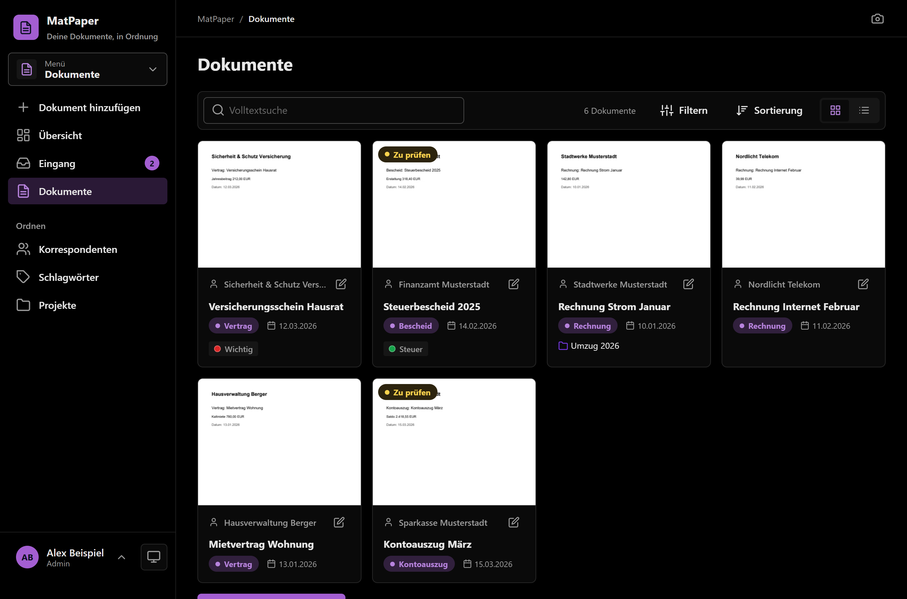
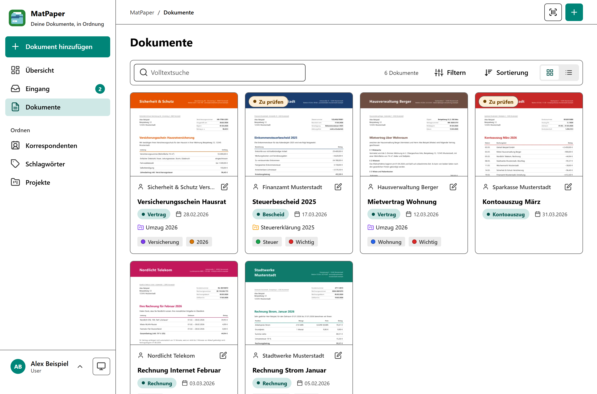
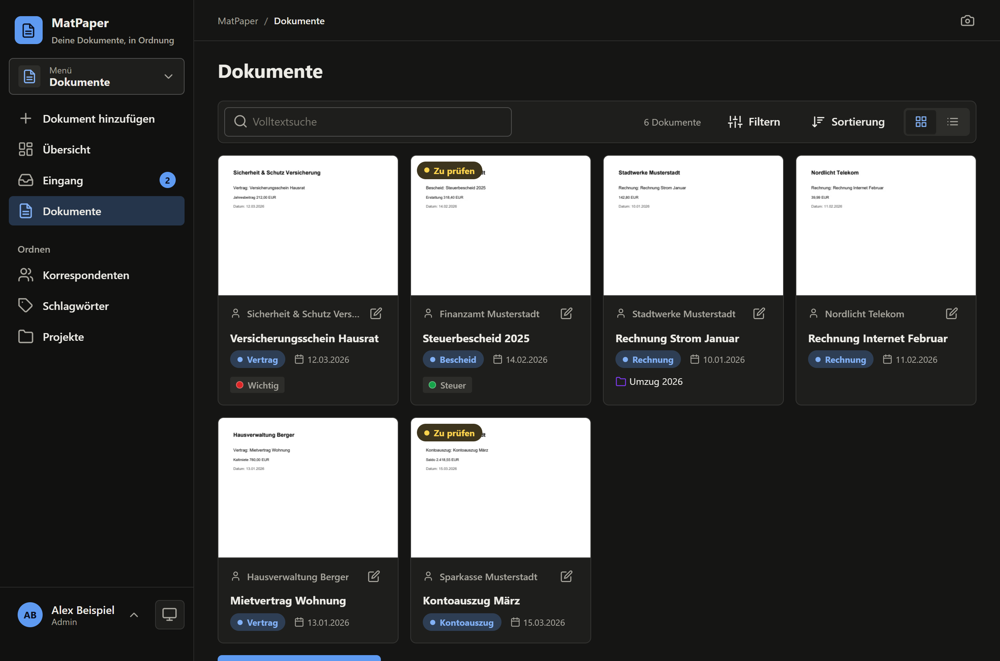
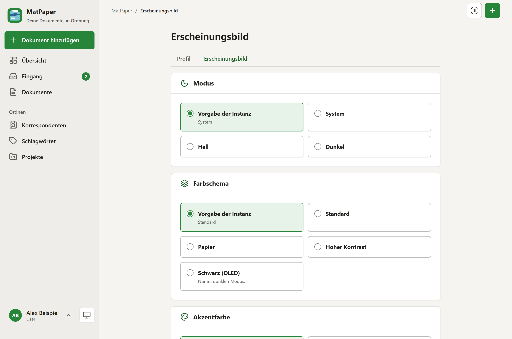
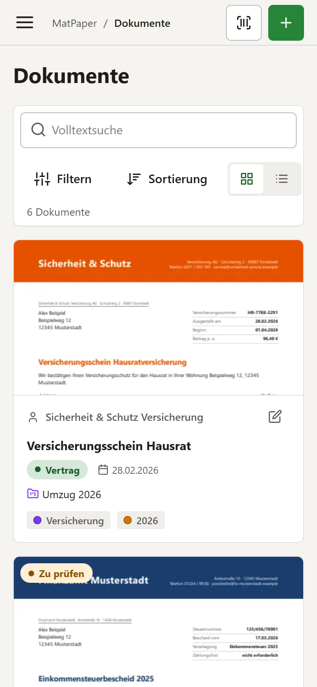

# MatPaper

MatPaper is a self-hosted, Dockerized document management system (DMS) — a lightweight
alternative to [Paperless-NGX](https://github.com/paperless-ngx/paperless-ngx) built on a
modern .NET stack.

## Quick start

Ready-made images are published to the GitHub Container Registry:

| Tag | Built from | Use it for |
|---|---|---|
| `ghcr.io/real-ttx/matpaper:latest` | `main` | releases |
| `ghcr.io/real-ttx/matpaper:nightly` | `dev` | the newest features |

### 1. Just run it

Copy this into `docker-compose.yml` and start it – nothing else needed:

```yaml
services:
  matpaper:
    image: ghcr.io/real-ttx/matpaper:latest
    restart: unless-stopped
    ports:
      - "4994:8080"
    volumes:
      - matpaper-data:/data
      - matpaper-storage:/storage
    depends_on:
      - db

  db:
    image: postgres:16
    restart: unless-stopped
    environment:
      POSTGRES_PASSWORD: matpaper
      POSTGRES_DB: matpaper
    volumes:
      - matpaper-db:/var/lib/postgresql/data

volumes:
  matpaper-data:
  matpaper-storage:
  matpaper-db:
```

```bash
docker compose up -d
```

Open **http://localhost:4994**. The first visit asks you to create the administrator account.
The database is only reachable from inside the compose network, so its password needs no
change for a default setup. The three volumes hold everything: `matpaper-data` the
configuration, session keys and thumbnails, `matpaper-storage` the filed documents,
`matpaper-db` the database. An update is `docker compose pull && docker compose up -d`; the
database is migrated on start.

Then, in the app: **System → Settings** for the public address and time zone,
**System → Connections** for a NAS, mailbox or cloud drive, **System → Import tasks** to
collect documents from a mailbox or folder.

### 2. With the folders of your NAS

Documents go to a *storage location*. To use a folder of your NAS instead of the Docker volume,
mount it below `/storage` and add it once under **System → Storage locations**. A Synology
keeps its shares under `/volume1`:

```yaml
  matpaper:
    volumes:
      - matpaper-data:/data
      - /volume1/documents:/storage/documents   # left: the NAS, right: what MatPaper sees
```

In the app enter the path **inside the container**: `/storage/documents`. Shares of other
systems work the same way (TrueNAS `/mnt/<pool>`, Unraid `/mnt/user`, plain Linux anywhere);
only the left side of the colon changes. A network share needs no mount at all: add it under
**System → Connections** as an SMB connection and use it as a storage location.

To keep the review inbox off the container host, point `MATPAPER_INBOX` at a mounted folder
(see [Data](#data)).

### 3. From source

```bash
docker compose -f docker-compose.dev.yml up -d --build
```

- **App:** http://localhost:4994
- **pgAdmin:** http://localhost:4995 (login `admin@matpaper.example.com` / `matpaper`)

## Screenshots

Taken from a demo instance with made-up documents (German UI; English is built in).

| | |
|---|---|
|  |  |
| **Documents** — thumbnails, full-text search and filters | **Inbox** — everything not yet filed, taken over with one click |
|  |  |
| **Detail** — preview, metadata, sharing | **Connections** — NAS, mailboxes and cloud drives, defined once |

**Themes.** Light, dark or system, four colour schemes (standard, paper, high contrast, black/OLED) and seven
accent colours — every combination is checked for readable contrast. Each user picks their own look (it follows the
account to every device); the administrator sets the default for everyone else and for the
sign-in page.

| | |
|---|---|
|  |  |
| **Paper** with amber | **Black (OLED)** with violet |
|  |  |
| **High contrast** with petrol | **Dark** with blue |

<p>
  
  
</p>

## Tech stack

- **.NET 10** (ASP.NET Core **Razor Pages**)
- **MatUi**, the design system of the Mat apps: one stylesheet, one script, one icon sprite, shipped as a copy in
  `src/MatPaper/wwwroot/matui` (no CDN: it works offline and as an installed app)
- **PostgreSQL** (via Npgsql / EF Core 10) with full-text search (`tsvector` + `pg_trgm`)
- Runs entirely in **Docker**

## Features (evolving)

- Document storage with correspondents, tags, projects and document types
- One inbox: everything that is not in the archive yet waits there — uploads, mail and
  folder imports, and files a storage search found — and is taken over with one click
- Storage locations on local folders, **SMB/CIFS shares**, **Google Drive** or **OneDrive** —
  no host mount needed; every location has a folder picker
- **Connections** (System → Connections): a NAS, a mailbox or a cloud drive is defined once
  — with a password / app password or **OAuth** (Gmail, Office 365, Google Drive, OneDrive) —
  and reused by storage locations and import tasks
- Full-text search over title and OCR text
- **Archive numbers** (optional, System → Archive numbers): labels with QR codes / bar codes to stick on the paper
  originals, read again when a scan is added or with the phone camera; separator sheets cut a scanned stack into
  documents; a stamp copy of a PDF with its number
- **E-invoices** (XRechnung, ZUGFeRD, Factur-X): amounts, due date, VAT ID, IBAN and buyer are read from
  the structured data; a bare XRechnung XML becomes a readable PDF with the XML kept next to it
- **Metadata files** (`.matpaper.json`) next to the documents, so an archive can be read back into a
  fresh database
- Import (IMAP / POP3 / filesystem / SMB) and export/backup tasks
- Themes per user, instance settings page (public address, time zone, default language),
  German and English UI
- Per-user ownership, sharing and a common area; cookie-based authentication with roles

See [PLAN.md](PLAN.md) for the full roadmap and phase breakdown.

## The look (MatUi)

The interface is built on **MatUi**, the toolkit of the Mat design system. MatPaper carries its own copy of it in
`src/MatPaper/wwwroot/matui` (`matui.css` with its parts in `css/`, `matui.js`, `matui.boot.js`, the icon sprite, `CHANGELOG.md` and
`matui.manifest.json`); do not edit those files, bring a newer copy:

```powershell
./scripts/update-matui.ps1                       # from the MatDesign of the dev stack (http://localhost:8060)
./scripts/update-matui.ps1 -Url https://design.example.com
```

The toolkit has a version of its own (the first line of `matui.css`, `MatUi.version`), and the files of one version belong together: the script copies
all of them. Read the changelog first (what the version changes and what the app has to do), then ask the toolkit's own tool where this copy stands and
look at the pages after a rebuild (MatDesign's `docs/VERSIONING.md` has the whole procedure):

```powershell
node <MatDesign>/tools/matui-check.js src/MatPaper/wwwroot/matui   # exit code 0: this version, nothing changed by hand
```

- **Pages** use the toolkit's classes (`mat-*`) and a set of tag helpers (`src/MatPaper/Controls`): `<mp-field asp-for="…">`, `<mp-picker>`,
  `<mp-toolbar>` with its search, filters and sort, `<mp-table>`, `<mp-pager>`, `<mp-button>`, `<mp-icon>`. They write the toolkit's markup,
  so a page stays short and every field behaves the same everywhere.
- **What only MatPaper has** (the cards of the inbox, the document tile, the scanner, the drop target) is in
  `wwwroot/css/matpaper.css` with the prefix `mp-`, built from the toolkit's colour and size tokens only, and in a few scripts under
  `wwwroot/js`. No inline styles, scripts or handlers, no colour of its own (the camera view is the one dark exception).
- **Icons** come from the sprite that the layout inlines once. The toolkit's own icons are used as they are; the few more MatPaper needs are
  listed in `scripts/matpaper-icons.txt` (names from the Lucide library of MatDesign) and written into `matui/matpaper-icons.svg`.
- **Logo and app icon**: three folders in three tones of teal and blue with a sheet in the back, on the accent green, drawn in three levels of detail in `src/MatPaper/wwwroot/icons`:
  `icon.svg` (the illustration: sign-in page, PWA icon of 512 px), `logo.svg` (the menu, 192 px) and `favicon.svg` (one bold shape for 16 and 32 px),
  plus `maskable.svg`. The SVGs are the source; `node scripts/make-icons.js` (needs `playwright-core` and Edge or Chrome) draws the PNGs
  (`icon-192`, `icon-512`, `maskable-512`, `apple-touch-icon`) and `favicon.ico` from them.
- **Texts** are English resource keys with a German translation in `Resources/SharedResource.de.resx`; the words the toolkit script writes
  itself (dialog buttons, form messages, the theme button) are handed over as attributes of the `<html>` element.
- **Theme**: mode, colour scheme and accent are attributes of `<html>` (`data-theme`, `data-scheme`, `data-accent`), written by the server from
  the account of the user (or the instance default) on every page.

## Archive numbers, labels and separator sheets

Paper originals get a number that finds them again in the folder (an *archive serial number*, ASN), as in Paperless.
It is a feature that is **off until you switch it on**: *System → Archive numbers → General → Use archive numbers*.
Switched off, nothing of it shows anywhere in the app and no file is searched for codes. The page has the tabs
*General* (the letters in front of the number, its digits, a slower and more thorough search for small labels),
*Labels* and *Separator sheets*.

- **Archive number** — every document can have one, unique among the documents that are not deleted.
  It is set on the document's page (a button gives the next free number, one reads it from the document, one
  scans the label with the camera), and is shown in the lists and the inbox, searchable (`ASN 17`, `asn17` or just
  `17`), filterable (with / without a number, from – to) and sortable (up or down).
- **Labels** (tab *Labels*): a PDF with sticker sheets (Avery L4731 / L7651 / L7160 / L7163, an own grid, or one
  label per page for a label printer), each with a QR code or Code 128 bar code of `ASN00017` and the number as
  text. The numbers continue where the last sheet ended; a test print with frames on plain paper uses up no numbers.
- **Reading them**: every PDF and image that is added (upload, drop, camera, folder / mail / SMB import, also
  inside ZIP archives) is searched for codes. A label on the first sheet gives the document its number; a
  number that another document has is not given twice — the document is filed without it and the
  upload / import log says so.
- **Separator sheets** (tab *Separator sheets*): scan a whole stack in one go with a separator sheet (code `PATCHT`,
  the Paperless value — its own sheets work as well) between the documents. MatPaper cuts the scan at the sheets,
  adds every document on its own (with the number on its first sheet) and leaves the sheets out.
- **Scanning a label with the phone**: the barcode icon in the header (and on the document page, beside the
  field) opens the camera; a label in the frame is read, and the scanner shows what it read (the number, the
  document) and waits: *Open* goes on, *Scan again* is for the label that was read by mistake (the one just
  turned down is not offered again while it stays in view). The picture is read on the server by the same
  reader that reads uploaded files, so it works on every phone — also where the browser has no barcode
  detection (Safari) — and tries the picture at several sizes: small or slightly soft codes are read where a
  plain reader gives up. A label may say `ASN00017`, `asn 17`, `ASN-17` or just `17`. Without a live camera
  (no HTTPS, no permission) a photo taken with the camera app does the same. A USB bar code scanner needs
  nothing: it types the code into the search field.
- **In file names**: the placeholder `{Asn}` in the path template of a storage location (or of an export rule) becomes
  `ASN00017` and nothing for a document without a number. Giving or taking away a number moves the file like any
  other change of the metadata (`{Asn} {Title}{Ext}`, `{Year}/{Asn} - {Title}{Ext}`).
- **Stamp copy** (document page → *Print with archive number*): a copy of the PDF with the number as a
  code and as text in a corner, to print and file; the stored document is not touched.

A small label (under 15 mm) is read reliably when the paper is scanned at 300 dpi or more; separator sheets from
100 dpi.

## Data

Application data (config, data-protection keys, thumbnails) is persisted in the `/data`
volume.

**Inbox.** The inbox lists every document that has not been taken into the archive yet,
no matter where it came from. Two kinds of entry share the list:

- *Staged* — uploaded, camera-scanned or imported. The file waits in a local staging
  folder (`/data/inbox` by default) and is moved into a storage location when you take the
  document over. To keep that folder off the container host (e.g. on a NAS), mount a share
  into the container and point `MATPAPER_INBOX` (or `Storage.InboxPath` in
  `/data/config/app.json`) at it; see the commented `matpaper-inbox` example in the compose
  files. It must be a local path inside the container because OCR and thumbnail generation
  run directly on it.
- *Found* — discovered by a storage search. The file already lies inside a storage
  location and nothing is copied. Taking it over either adopts it where it is or re-files
  it by the location's path template. Files you do not want are ignored, not deleted: the
  entry keeps the next search from offering them again.

Nothing is read from disk during a search, so pointing MatPaper at a large archive is
cheap. Text recognition for found files starts when you take one over or press "analyze".

A storage location can run its search on a schedule, like the import and export tasks. Every
run, manual or scheduled, is recorded in the task history with its log.

Documents in the common area appear in everybody's inbox and everybody may take them over or
ignore them. Deleting stays with the owner. A deleted document goes to the bin, reachable
through the "Deleted" filter on the document list, and can be restored as long as its file
still exists.

**Storage locations** (System → Storage locations) hold the filed documents. A location is
a local folder (such as the `/storage` volume or a mounted share), an SMB/CIFS share reached
over the network, or a Google Drive / OneDrive folder — the last two through a saved
[connection](#connections-and-oauth). Files are placed by the location's
path template, e.g. `{Correspondent}/{Year}/{DocumentType}/{Date} {Title}{Ext}`. Import
tasks that skip the inbox file directly into their configured location. The search icon on
a location looks through it for files MatPaper does not know yet; which extensions it picks
up, who owns the finds, whether they go to the common area and how often the search runs is
configured per location.

**What an import remembers.** An import task does not read everything again on every run.
IMAP tasks store the folder's position (UIDVALIDITY and the highest UID handled) and ask the
server only for newer messages; POP3 tasks remember the UIDLs they handled; folder and SMB tasks
remember path, size and modification time of the files they handled. If the server renumbers a
folder, or the task's folder, filters or period change, the task starts over. "Start over" on
the task does the same by hand. The content hash stays the safety net: a file that already
exists is never filed twice.

Under *Period* a task can be limited to the last N days or to items from a given date on — for
IMAP the server does that filtering, so an old mailbox is not fetched at all. The preview in
the wizard looks at the newest 200 to 5000 items (POP3: at most 500, as it has to download
each message) and shows 25 at a time; it ignores the remembered position so it always shows
what the filters would catch.

**Adding files.** Drop files anywhere in the app - on any page - and they go to your inbox in the
background; a small panel shows the progress and what became of each file (a folder is read, too). On
the *Add document* page the files join the list there, where title, correspondent, type, project and
tags can be set first. PDFs, images (PNG, JPEG, TIFF, BMP, WebP) and XML (XRechnung) are documents; a
**ZIP archive** is opened and each PDF, image and XML in it becomes a document of its own (folders,
hidden files and other types are left out; archives inside an archive are opened one level deep; the
archive itself is not kept). The same goes for every way a file comes in: a ZIP in a watched folder or on an
SMB share is opened with the task's file pattern (`*` takes it), a ZIP attached to a mail when `.zip`
is in the task's attachment extensions (new tasks have it). With *After import: delete / move* the
archive is only removed once everything in it was imported or known already. Limits against
oversized archives: 2000 files, 200 MB per file, 1 GB unpacked.

**Scanning with the camera.** The *Add document* page can scan paper with the camera of the phone or the
webcam: pages are found automatically, straightened and cleaned up (enhanced / original / grey / black and
white), several pages become one PDF. *Live camera* shows an outline on the page while you hold the camera over it and
takes the photo by itself once the page is in view, close enough, not cut off by the edge, lying still and
sharp (it waits for a crisp picture, and for a page that is far away says "Move closer", for a page that
reaches beyond the picture "move back"). *Camera app* hands the job to the camera app of the phone (the sharper
photo) and finds the page afterwards; if nothing is found the whole photo is used and a note says so, and a
page that is cut off at the edge of the photo is pointed out. The *Sensitivity* button (Low / Medium / High)
decides how sure the scanner has to be before it calls something a page; *Crop* sets the corners by hand and
*Detect again* tries once more, more generously. The page is not looked for as "the brightest blob" but by
its sides: the long straight edges of the picture are found, every set of four that could bound a sheet is a
candidate, and each is judged by how much of every side is a real step between the sheet and its surroundings,
by its shape and size, and by its inside (white and calm, not a pattern). That also copes with a dark letterhead,
a finger over a corner, a shadow, a sheet on a white desk or between other papers. The weights of the judgement
were fitted on photographed-like test scenes (`tools/scanner-bench`, see the README there), which is also how
a case that fails in practice can be added and the scanner tuned again.

**E-invoices.** A PDF with embedded invoice data (ZUGFeRD, Factur-X) and a standalone XRechnung
`.xml` are recognised everywhere a file comes in (upload, import tasks, storage search). The invoice
facts - gross, net and VAT amount, due date, VAT ID, IBAN, buyer, buyer reference - are stored with
the document, shown in its detail view and marked with an *E-invoice* badge. A bare XML is rendered
into an A4 PDF so it behaves like any other document; the original is saved next to it as
`{file}.pdf.xml` and can be downloaded from the document. To collect e-invoices from a mailbox or
folder add `.xml` to the task's attachment extensions.

**Metadata files.** A storage location can write a `{file}.matpaper.json` next to every filed
document (System → Storage locations → *Write metadata files*). It holds title, date, type,
correspondent, project, tags, invoice data and the review state - by name, not by id. Whatever
moves, renames or deletes the document takes this file and an `.xml` companion along. Import tasks
(folder, SMB) and the storage search read the file back, so pointing MatPaper at an archive restores
everything it knew; missing types, correspondents and tags are created by name. Empty folder
placeholders follow the instance language (*Unsortiert* / *Ohne Typ* / *Ohne Titel* or *Unsorted* /
*Unfiled* / *Untitled*).

## Connections and OAuth

**Connections** (System → Connections) hold *where* something is and *how to sign in*:
SMB shares, IMAP/POP3 mailboxes, Google Drive and OneDrive. Storage locations and import tasks
pick a saved connection instead of carrying their own host and password. Secrets are encrypted
with ASP.NET Data Protection (keys in `/data/keys`) and never shown again.

Gmail, Office 365, Google Drive and OneDrive sign in with **OAuth**. There is no shared
MatPaper app — you register your own with Google Cloud or Azure, enter its client ID and
secret in the connection and press *Connect*:

1. Set the **public address** of your instance under System → Settings (or with
   `MATPAPER_PUBLIC_URL`). The page then shows the **redirect URI**
   (`<address>/System/Connections/OAuthCallback`); register exactly that with Google/Azure.
2. Google: publish the Cloud project as *In production*, otherwise the authorization expires
   after seven days. Scopes: `https://mail.google.com/` (mail) or `…/auth/drive` (Drive).
3. Microsoft: delegated `Files.ReadWrite.All` (OneDrive) or the IMAP/POP scopes (mail),
   plus `offline_access`.

Where an app password is simpler (e.g. Gmail with 2-factor), choose the password sign-in.

## Settings

System → Settings edits the public address, the time zone (used for every displayed time and
for task schedules) and the default language/theme, and shows version, data folder and
database. Changes are written to `/data/config/app.json` and apply immediately. A value pinned
by an environment variable (`MATPAPER_PUBLIC_URL`, `MATPAPER_TZ`) is shown locked.
Database, data folder and inbox folder are read at startup.

### Environment variables

| Variable | Meaning |
|---|---|
| `MATPAPER_DATA` | the data folder (default `/data`): `config/app.json`, keys, thumbnails, the inbox |
| `MATPAPER_INBOX` | the inbox staging folder (default `{data}/inbox`), see "Data" |
| `MATPAPER_TZ` | the time zone; wins over the settings page |
| `MATPAPER_PUBLIC_URL` | the public address; wins over the settings page |
| `APP_VERSION` | the version shown in the footer (set by the image build) |
| `MAT_API_KEY` | the key of the platform API (`X-Api-Key` on `/api/*`); not set = only a token of MatIdentity is accepted. Mattiverse sets it |
| `MATIDENTITY_AUTHORITY` | the address of MatIdentity (`https://id.example.com`). Set = sign-in through MatIdentity; not set = nothing changes |
| `MATIDENTITY_CLIENT_ID` | the client of MatPaper in MatIdentity (default: `matpaper`) |
| `MATIDENTITY_CLIENT_SECRET` | its secret |
| `MATIDENTITY_INTERNAL_URL` | optional: where MatPaper reaches MatIdentity from inside Docker (`http://matidentity:2300`); the browser keeps using `MATIDENTITY_AUTHORITY` |

None of the `MAT_*` / `MATIDENTITY_*` variables is required.

## Platform API and sign-in through MatIdentity

MatPaper follows the platform contract of the Mat apps (MatDesign `docs/PLATFORM.md`), so that Mattiverse (or any other
consumer) can show it, watch it and set it up without knowing it beforehand. The shared package **MatPlatform** is a copy in
`src/MatPaper/MatPlatform/` (MatDesign `node tools/matplatform-copy.js src/MatPaper`; never edit it here, `matplatform.version`
names the version and the hashes); `src/MatPaper/Platform/PaperPlatform.cs` describes MatPaper and supplies the values through
`InstanceStatusService` and `InstanceSettingsService`.

| Endpoint | What |
|---|---|
| `GET /api` | the description (anonymous): pages *Overview* and *Settings*, the tiles, the fields, the links, the roles `admin` and `user` |
| `GET /api/health` | `ok` / `degraded` (no active administrator yet) / `down` (the database cannot be read; HTTP 503). The Docker `HEALTHCHECK` calls it |
| `GET /api/state[/{key}]` | the tiles: `documents` (managed, not deleted or ignored), `inbox` (waiting in all inboxes), `ocrQueue` (waiting for text recognition), `ocrFailed` (text recognition failed), `storage` (bytes of the documents), `lastDocument` (when the last one was added), `users` (active accounts) |
| `GET`/`PUT /api/configure` | four settings of `app.json`: `publicUrl`, `timeZone`, `language` (`de-DE`/`en-US`), `archiveNumbers` (the feature on or off). A value pinned by `MATPAPER_PUBLIC_URL` / `MATPAPER_TZ` cannot be changed here; everything else stays on the System pages |
| `POST /api/actions/{id}` | none: the actions are links (*Open*, *Inbox*, *Administration*) |

Everything but `/api` and `/api/health` needs `X-Api-Key: <MAT_API_KEY>` or a bearer token of MatIdentity for MatPaper.
They answer before the first setup too.

**Sign-in through MatIdentity** is on as soon as `MATIDENTITY_AUTHORITY` is set: the sign-in page goes straight on to
MatIdentity (authorization code with PKCE) and comes back signed in. Register the redirect address `<public address>/signin-oidc`
and the signed-out address `<public address>/signout-callback-oidc` with the client. The local sign-in stays at
`/Account/Login?local=1` (a way in when MatIdentity is down); after a sign-out (`?signedOut=1`) or a failure (`?ssoError=1`) the page
does not sign in again by itself.

- A person is found by the claim `sub` (`User.ExternalSubject`); the first sign-in creates the user (user name, display name, e-mail
  from the claims, no local password).
- An existing account with the same e-mail address is **not** entered by the address alone: the page asks to sign in once with that
  account's password (`?local=1&link=1`, valid ten minutes, with *Cancel*); only then is it linked. Another account signing in there links
  nothing; several accounts with the address, or one linked with another person, are refused; a deactivated account too.
- The claim `role` (`admin` or `user`), when MatIdentity sends one, sets the role at every sign-in; the last active administrator is
  never demoted. Without the claim MatPaper's own user management decides, as before.
- The sign-out ends the session at MatIdentity too (the ID token is kept with the session).

## Tests

```bash
dotnet test MatPaper.slnx
```

The tests that start the whole app need PostgreSQL: `MATPAPER_TEST_DB` is an admin connection string, e.g.
`Host=localhost;Port=5432;Username=postgres;Password=matpaper` (every test class creates and drops a database of its own).
Without it those tests are skipped and the rest runs alone. The CI runs all of them against a PostgreSQL service.
